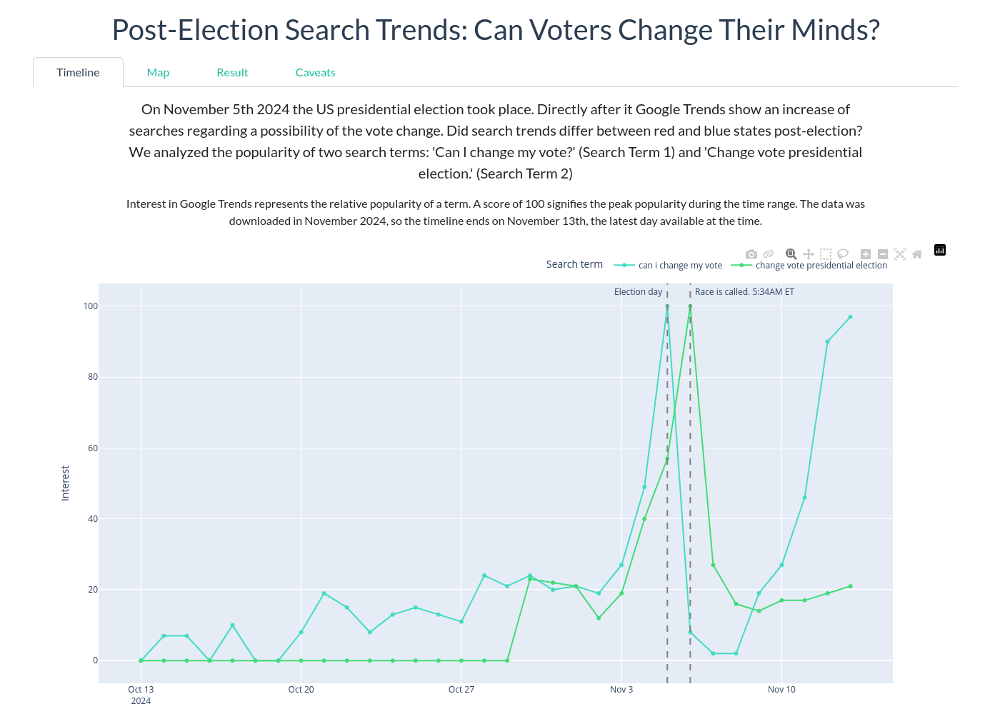
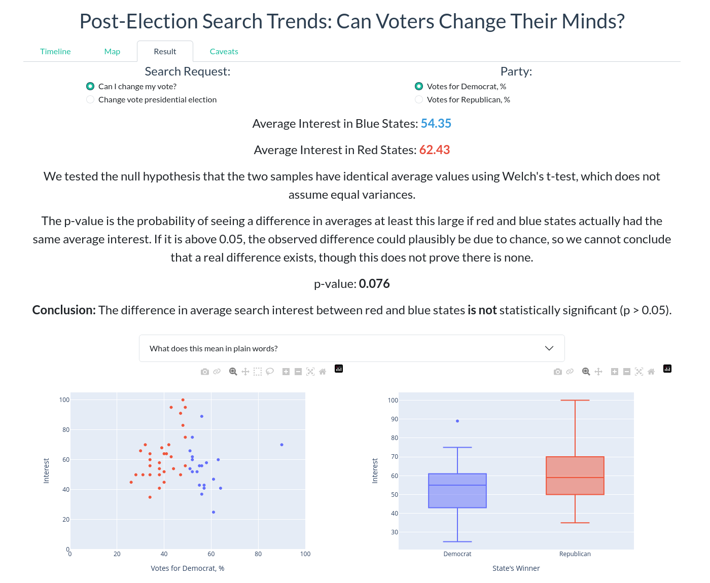

# US 2024 Post-Election Search Trends: Can Voters Change Their Minds?

An interactive dashboard comparing Google searches about changing one's vote in red and blue states after the 2024 US presidential election.

**Live dashboard:** https://aleksandrzin.pythonanywhere.com

> **Note:** the PythonAnywhere deployment is currently not working. To see the dashboard, [run it locally](#run-locally).



## Question

Right after the 2024 election, a TikTok video pointed out a jump in Google searches about changing one's vote. Did this interest differ between states that voted Republican (red) and states that voted Democrat (blue)?

## Project goals

This personal project started as a way to check a claim from a TikTok video with real data. It was also a way to learn Dash and Plotly, practise scraping and cleaning data, and apply a statistical test to a real question. The 2026 update was made with Claude Code, as practice in working with AI coding agents.

## Findings

Neither search term shows a statistically significant difference between red and blue states.

| Search term | Average interest, red states | Average interest, blue states | Welch's t-test p-value |
|---|---|---|---|
| "Can I change my vote?" | 62.4 (30 states) | 54.4 (20 states) | 0.076 |
| "Change vote presidential election" | 14.3 (25 states) | 18.2 (14 states) | 0.56 |

Red states searched "Can I change my vote?" somewhat more, but a gap this size could plausibly appear by chance (p > 0.05). This is not proof that there is no difference: with only 14 to 30 states per group, the test can miss small real differences.

## Method

- **Search terms:** "Can I change my vote?" and "Change vote presidential election".
- **Search interest:** Google Trends state-level interest for October 13 to November 13, 2024. It runs from 0 to 100 and is relative: it shows how popular the term was compared with all searches in that state, not how many searches there were.
- **Red or blue:** each state (and DC) is labelled by the 2024 presidential winner there.
- **Test:** Welch's two-sample t-test at α = 0.05. The red and blue groups differ in size and spread, so the test does not assume equal variances.

## The dashboard

- **Timeline:** a line chart showing when the searches spiked around the election.
- **Map:** a state map comparing search interest with how each state voted.
- **Result:** the red vs blue comparison and its test result, with a scatter and a box plot.
- **Caveats:** what the data and the analysis can and can't tell us.



## Limitations

- **Relative scores:** Google Trends interest is relative within each state, and each search term is scaled to its own peak of 100, so the two terms can't be compared directly.
- **A state's color doesn't tell us who searched:** every state has voters from both parties.
- **Searching isn't necessarily regretting:** people search out of curiosity, because of the news, or to check the rules.
- **A November 2024 snapshot:** the data was downloaded in November 2024 and ends on November 13, when interest in "Can I change my vote?" was still near its peak.
- **Missing states:** Google reports no score where there were too few searches, so some small states are left out (1 for the first term, 11 plus DC for the second).

The full list is on the dashboard's Caveats tab.

## Data sources

- **Votes:** scraped from the [Reuters 2024 results page](https://www.reuters.com/graphics/USA-ELECTION/RESULTS/zjpqnemxwvx/) into `data/geo_df.csv`. They may differ slightly from the final certified results, which were not yet available.
- **State boundaries:** GeoJSON from [MappingAPI](https://github.com/PublicaMundi/MappingAPI) (`data/us-states.json`).
- **Google Trends:** exported manually from Google Trends. Files are named `GT_<region|timeline>_<term>_US_<start>_<end>.csv`.
  - `data/raw/GT_2024/`: downloaded in November 2024, used by the dashboard.
  - `data/raw/GT_2026/`: a later re-download, kept for reference only. Google Trends samples searches, so re-downloads differ, and these region files cover too few states (29 and 2) to use.

## Project structure

```
google-election/
├── dashboard.py              # Dash app: layout, tabs and callbacks
├── scrap_script.py           # builds the processed CSVs from the raw data
├── requirements.txt
├── src/
│   └── utils.py              # data loading, figures and Welch's t-test
├── data/
│   ├── geo_df.csv            # per-state votes and search interest
│   ├── tl_df.csv             # daily search interest
│   ├── us-states.json        # state boundaries (GeoJSON)
│   └── raw/
│       ├── GT_2024/          # Google Trends exports used by the dashboard
│       ├── GT_2026/          # later re-download, reference only
│       └── state_*.json      # state name and abbreviation lookups
├── assets/
│   └── bootstrap.css         # theme, loaded by Dash automatically
└── docs/                     # README screenshots
```

## Run locally

```bash
git clone https://github.com/AleksandrZin/google-election
cd google-election
python3 -m venv venv
source venv/bin/activate        # Windows: venv\Scripts\activate
pip install -r requirements.txt
python dashboard.py
```

The dashboard runs at http://localhost:5000.

## Regenerate the data

The processed CSVs are already in the repo, so you only need this if you change the raw data.

```bash
python scrap_script.py --timeline-only   # rebuild data/tl_df.csv from the raw Google Trends files (offline)
python scrap_script.py                   # also re-scrape Reuters and rebuild data/geo_df.csv
```

The full run re-scrapes a 2024 Reuters page and overwrites `data/geo_df.csv`. If that page has changed, the result may be empty or wrong, so prefer `--timeline-only` unless you need fresh vote data.

## License

[MIT](LICENSE.txt)
